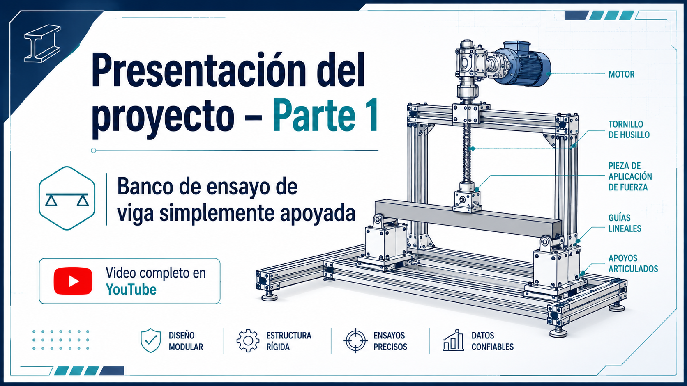
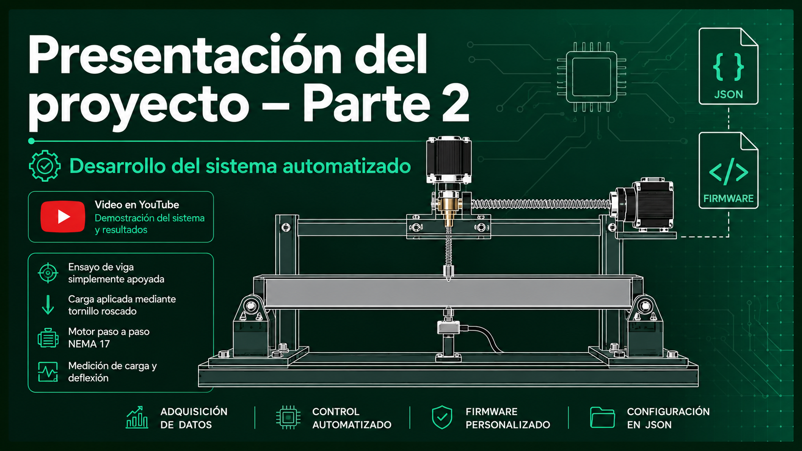

# Simply Supported Beam Test Bench

Research and development of a **digital simply supported beam test bench** for controlled load application, beam deflection analysis, motion control, data acquisition, and experimental repeatability validation.

The project is being developed in stages so that each subsystem can be validated independently before adding the next layer of complexity.

## Current Development Branch: `motor-repeatability`

The purpose of this branch is to validate the **mechanical motion system and its repeatability** before integrating electronic force measurement.

At this stage, force is measured externally with a **scale**.

The main experimental objective is to command the same absolute motor position repeatedly and verify whether approximately the same force/weight reading is obtained each time.

## Current Stage Objectives

This branch focuses on validating:

- repeatable homing;
- absolute positioning referenced to HOME;
- controlled forward and return motion;
- mechanical travel limits;
- safety limits in firmware;
- repeatability for a fixed number of motor steps;
- relationship between actuator position and measured load.

The following are intentionally outside the scope of this branch:

- load cells;
- movement commands expressed in revolutions;
- Wi-Fi;
- Blynk;
- local Python GUI;
- RMT step generation;
- fully automated beam testing.

## Hardware

Current motion-control hardware:

- ESP32-S3;
- NEMA17 stepper motor;
- A4988 driver;
- HOME limit switch;
- lead screw / threaded screw;
- linear guides.

### A4988 pins

```cpp
#define PIN_A4988_EN    2
#define PIN_A4988_STEP  38
#define PIN_A4988_DIR   37
```

### HOME switch

```cpp
#define PIN_FC_HOME 13
```

The switch uses `INPUT_PULLUP`.

```text
LOW  = FREE
HIGH = ACTIVE
```

### Direction validated with the real mechanism

```cpp
#define DIR_HOME LOW
#define DIR_AWAY HIGH
```

```text
HOME = mechanism moves upward
AWAY = mechanism moves downward / away from HOME
```

## A4988 configuration

```text
ENABLE LOW  = enabled
ENABLE HIGH = disabled
```

MS1, MS2, and MS3 are connected to GND.

The driver currently operates in:

```text
full-step
200 steps = 1 NEMA17 revolution
```

Full-step is intentionally kept during the first mechanical validation stage because it provides a simple and auditable step-to-position relationship.

## Preliminary Mechanical Relationship

Initial measurements with the assembled mechanism indicate approximately:

```text
1 revolution = 200 steps ≈ 8 mm
1 mm ≈ 25 steps
```

This value is considered provisional and can be refined later with more precise measurement equipment.

The observed total mechanical travel is approximately:

```text
≈ 20 mm
```

Firmware limits must remain conservative enough to prevent the mechanism from being driven against a mechanical stop.

## Firmware Architecture

The firmware is modular:

```text
simply_supported_beam/
├── simply_supported_beam.ino
├── a4988_stepper.h
├── a4988_stepper.cpp
├── beam_config.h
├── beam_config.cpp
├── home_switch.h
├── home_switch.cpp
└── TEST_COMMANDS.txt
```

Responsibilities are separated as follows.

### `simply_supported_beam.ino`

Contains:

- main FSM;
- physical operation decisions;
- HOME sequence;
- absolute movement logic;
- logical position tracking.

The FSM is the only layer that decides physical operating sequences.

### `beam_config.h/.cpp`

Central configuration and host-communication object.

Contains:

- Serial communication;
- JSON protocol;
- persistent configuration;
- RAM copy of configuration;
- `Preferences` / NVS;
- runtime pending requests;
- JSON responses and status messages.

The configuration object does **not** move hardware and does **not** execute the FSM.

### `a4988_stepper.h/.cpp`

Provides A4988 hardware primitives:

- enable / disable;
- direction;
- cooperative STEP generation;
- moving / busy state.

STEP generation currently uses `micros()`.

The short `delayMicroseconds()` used for STEP pulse timing is an accepted design decision for this stage.

### `home_switch.h/.cpp`

Encapsulates:

- HOME switch GPIO;
- electrical logic;
- raw switch reading.

Debounce and HOME decisions remain in the FSM.

## Absolute Positioning

No test movement is allowed until HOME has completed successfully.

After a successful HOME:

```text
homed = true
current_position_steps = 0
```

All test positions are absolute and referenced to that zero.

Valid range:

```text
0 <= target_steps <= max_position_steps
```

Negative positions are never allowed.

After an ESP32 reset, the logical position becomes invalid and HOME must be performed again.

## Main JSON Commands

### HOME

```json
{"cmd":"home"}
```

Searches for the physical reference switch and establishes:

```text
position_steps = 0
```

### Absolute movement in steps

```json
{"cmd":"move_abs_steps","steps":200}
```

The requested value is an **absolute position relative to HOME**.

Example:

```text
current position = 100
target = 200
actual movement = 100 steps AWAY
```

Example in the opposite direction:

```text
current position = 200
target = 50
actual movement = 150 steps toward HOME
```

### Return to logical zero

```json
{"cmd":"move_abs_steps","steps":0}
```

This returns to the previously established logical zero.

It does **not** execute a new HOME sequence.

### STOP

```json
{"cmd":"stop"}
```

Immediately aborts HOME or a movement in progress.

### ENABLE

```json
{"cmd":"enable"}
```

### DISABLE

```json
{"cmd":"disable"}
```

## Persistent NVS Parameters

The firmware currently stores these parameters using ESP32 `Preferences`:

```text
step_period_us
home_slow_period_us
home_backoff_steps
home_debounce_ms
home_seek_max_steps
move_fast_period_us
max_position_steps
```

Final safety values will be adjusted after the mechanical geometry is fully characterized.

## Homing Sequence

The validated HOME sequence is:

```text
fast search
→ first raw contact
→ debounce validation
→ move away until switch release
→ release debounce
→ additional backoff
→ slow approach
→ second contact
→ debounce validation
→ HOME OK
→ logical position = 0
```

If HOME starts with the switch already active, the firmware skips the initial fast search and begins by releasing the switch.

Safety step limits prevent indefinite motion if the switch fails.

## Cooperative STEP Generation

STEP is currently generated cooperatively using `micros()`.

```text
loop() keeps running continuously
no blocking motion loops are used
```

This architecture leaves room for future coexistence with:

- networking;
- watchdog;
- timers;
- additional sensors;
- Blynk;
- other peripherals.

RMT or another hardware STEP generator may be evaluated later without changing the main FSM architecture.

## Mechanical Repeatability Test

The main experiment planned for this branch is:

```text
HOME
↓
move to absolute position N
↓
measure load using an external scale
↓
return to position 0
↓
move again to the same absolute position N
↓
measure again
↓
repeat
```

Each repetition starts from zero and approaches the target from the same direction.

The central question is:

```text
same absolute step position
≈
same measured load
```

This will be used to evaluate the repeatability of the complete mechanical chain before adding load cells.

## Current Validation Status

The following have already been physically validated:

- A4988 enable control;
- real motor directions with the assembled mechanism;
- HOME starting with the switch free;
- HOME starting with the switch active;
- debounce against real microswitch bounce;
- STOP during HOME;
- HOME safety step limit;
- persistent NVS configuration;
- movement rejected before HOME;
- negative absolute positions rejected;
- configurable maximum absolute position;
- absolute movement in both directions;
- return to logical position zero;
- STOP during absolute movement while preserving the reached position;
- logical position invalidated after ESP32 reset;
- preliminary mechanical relationship of approximately 8 mm/revolution.

## Project Presentations

### Project Presentation — Part 1

[](https://youtu.be/BdN0YVFE4YY?si=Eqhs2K3H0VstGYXS)

### Project Presentation — Part 2

[](https://youtu.be/o4Hn4ybJFnE?si=RUoY4Uxe1_6EQrKa)

## Documentation

The current project documentation is stored in the [`docs/`](docs/) directory.

- [Bill of Materials — v1.01](docs/simply_supported_beam_BOM_v1.01.pdf)
- [Project Development — v1.02](docs/simply_supported_beam_develop_v1.02.pdf)
- [Project Guidelines — v2.02](docs/simply_supported_beam_guidelines_v2.02.pdf)
- [Electrical Schematic — v1.00](docs/simply_supported_beam_sch_v1.00.pdf)
- [Project Document — v2.02](docs/simply_supported_beam_v2.02.pdf)

> Keep these filenames unchanged when copying the PDF files into `docs/`, so the links above remain valid.

## Repository Structure

The repository is intended to contain multiple project areas as development progresses.

Current structure:

```text
simply-supported-beam/
├── docs/
│   ├── images/
│   │   ├── project-presentation-part1.png
│   │   └── project-presentation-part2.png
│   ├── simply_supported_beam_BOM_v1.01.pdf
│   ├── simply_supported_beam_develop_v1.02.pdf
│   ├── simply_supported_beam_guidelines_v2.02.pdf
│   ├── simply_supported_beam_sch_v1.00.pdf
│   └── simply_supported_beam_v2.02.pdf
├── simply_supported_beam/
│   ├── simply_supported_beam.ino
│   ├── a4988_stepper.h
│   ├── a4988_stepper.cpp
│   ├── beam_config.h
│   ├── beam_config.cpp
│   ├── home_switch.h
│   ├── home_switch.cpp
│   └── TEST_COMMANDS.txt
├── .gitignore
└── README.md
```

Local Arduino libraries are not part of the repository and should be excluded with:

```gitignore
/simply_supported_beam/libraries/
```

## Firmware Versioning

Every firmware code modification must increment:

```cpp
#define FW_VERSION "simply_supported_beam X.XX"
```

This includes small fixes and diagnostic changes.

The version number shown at boot is used to:

- confirm that Arduino IDE actually rebuilt and uploaded the new firmware;
- identify exactly which firmware is running;
- make it possible to resume development confidently after working on other projects.

## Next Stages

After mechanical repeatability has been validated with the external scale:

1. define the final experimental procedure;
2. integrate electronic force acquisition;
3. add load cells;
4. develop the local Python GUI;
5. automate the complete beam test;
6. evaluate alternative STEP generation methods if necessary.
